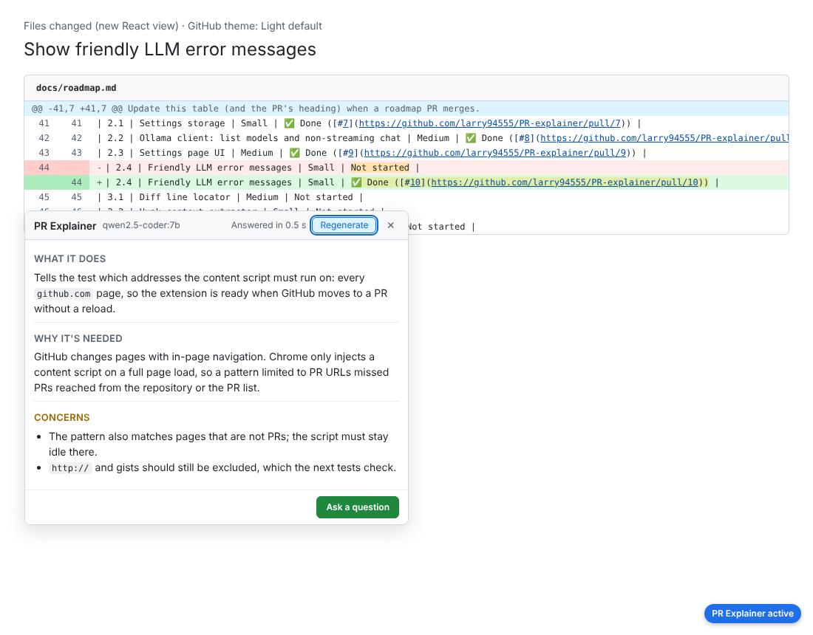
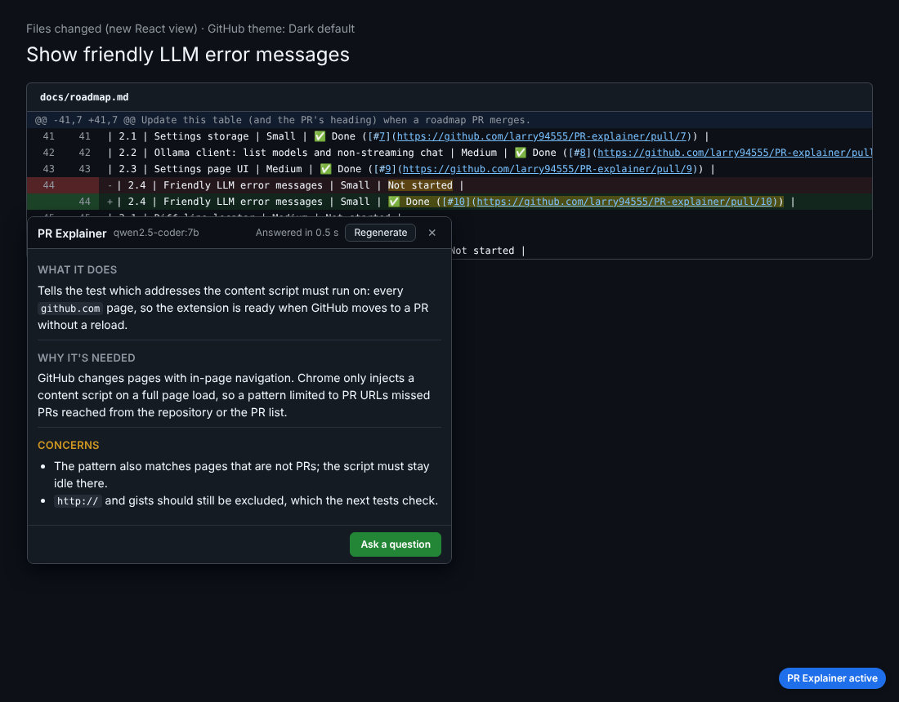
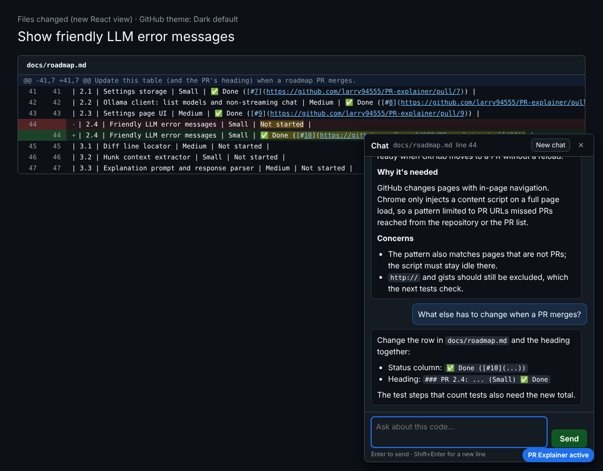
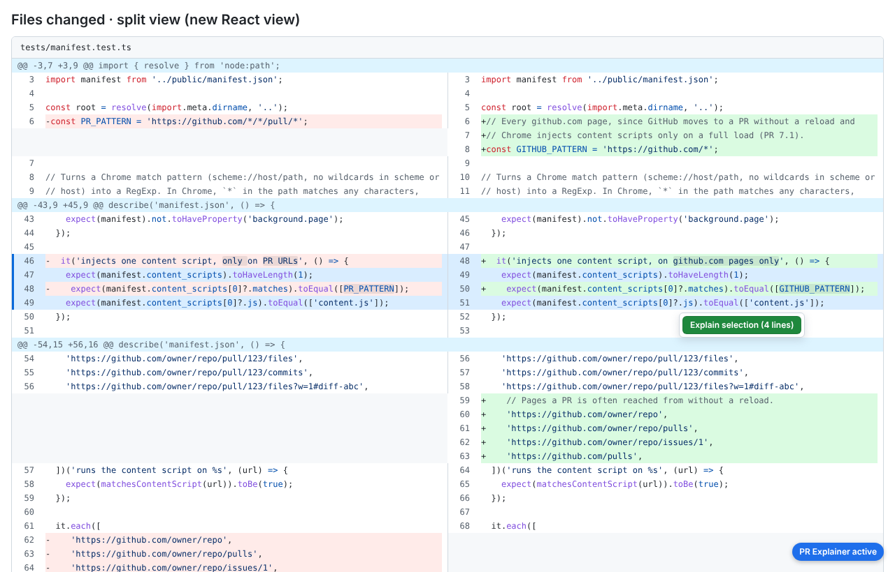
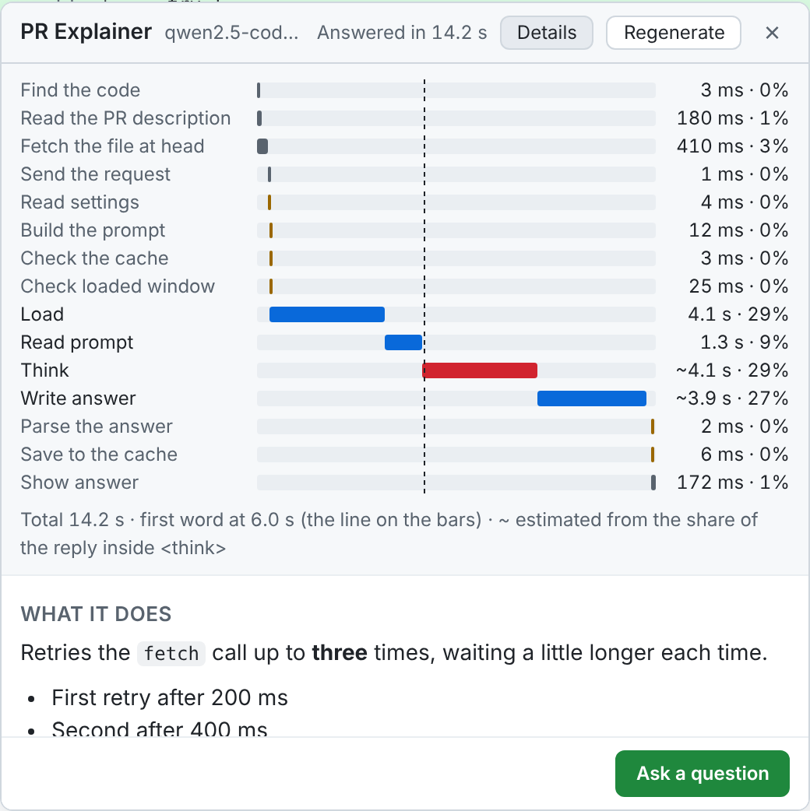
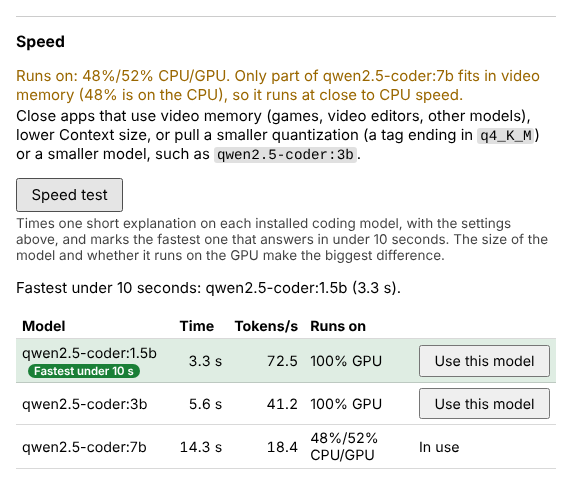

<h1 align="center">PR Explainer</h1>

<p align="center">
  <strong>Click any line in a GitHub pull request and get a plain-language explanation from an LLM running on your own laptop.</strong>
</p>

<p align="center">
  <a href="https://github.com/larry94555/PR-explainer/actions/workflows/ci.yml"></a>
  
  
  
  
</p>

<p align="center">
  
</p>

PR Explainer is a Chrome extension for code review. Open a pull request on github.com, go to **Files changed**, and click a line of code. A popup next to the line tells you **what the code does**, **why the change is needed**, and **any concerns** (bugs, edge cases, security or performance). From there you can open a chat and ask follow-up questions about the same code.

Everything runs on your machine. The extension talks to [Ollama](https://ollama.com) on `localhost`, so your code is never sent to a cloud service, there are no API keys, and there is no telemetry. See [PRIVACY.md](PRIVACY.md) for how that is enforced.

## Contents

- [How it works](#how-it-works)
- [Screenshots](#screenshots)
- [Getting started](#getting-started)
  1. [Install Ollama and a model](#1-install-ollama-and-a-model)
  2. [Build the extension](#2-build-the-extension)
  3. [Load it into Chrome in Developer mode](#3-load-it-into-chrome-in-developer-mode)
  4. [Use it on GitHub](#4-use-it-on-github)
- [Documentation](#documentation)
- [Project status](#project-status)

## How it works

1. **You click a line** (or drag across several lines) in a PR's diff. The extension works out which file, which line, and which side of the diff you clicked, in both unified and split view.
2. **It gathers context** from the page: the diff around the line, the enclosing function from the full file at the PR's head commit, and the PR's title and description. The prompt is trimmed to fit the model's context window, and the code you clicked is never cut.
3. **The local model answers.** The extension's service worker sends the prompt to Ollama on `localhost` and streams the reply back. The popup shows the three section headings with placeholders and a ticking time while the model writes, then each section whole as soon as it is written, **What it does** first (or word by word, if you tick **Show answers as they are written** in the settings). You can stop it at any time.
4. **The popup shows three sections:** *What it does*, *Why it's needed*, and *Concerns*. Answers are cached, so clicking the same line again is instant, and **Regenerate** asks for a fresh one.
5. **Ask a question** opens a chat that already knows the code and the explanation. While the chat is open, clicking other lines adds them to the same conversation.

The popup, the chat and the selection button follow GitHub's light or dark theme, work from the keyboard (**Alt+E** explains the focused line), and are labelled for screen readers. A toolbar button turns click-to-explain off when you just want to review normally.

For the full picture, see [Design and data flow](docs/design-and-data-flow.md).

## Screenshots

The popup and chat follow whichever GitHub appearance you use: light, dark (including dimmed and high-contrast variants), or "sync with system", and they switch live when the setting changes.

| Light theme | Dark theme |
|---|---|
|  |  |
| **Chat in the dark theme** | **Split view, selecting a block of lines** |
|  |  |
| **Where the time went** | **Speed test on the settings page** |
|  |  |

<sub>Screenshots were taken while each feature was built, on saved GitHub diff pages with a fake model that streams a canned reply, so the times shown are not real model speeds. Real numbers are in <a href="docs/latency.md">docs/latency.md</a>.</sub>

## Getting started

The extension is not in the Chrome Web Store yet. You build it from source and load it into Chrome yourself, which takes about ten minutes.

**You need:** Google Chrome (or another Chromium browser such as Edge or Brave), Git, and Node.js 22.22.2+ or 24.15+.

### 1. Install Ollama and a model

1. Download and install Ollama from [ollama.com/download](https://ollama.com/download) (Windows, macOS or Linux). It runs in the background and listens on `http://localhost:11434`.
2. Pull a coding model. Pick one that suits your hardware:

   ```sh
   # Recommended: small and fast enough to aim at a 2-second answer
   ollama pull qwen2.5-coder:1.5b

   # A slow CPU: even smaller
   ollama pull qwen2.5-coder:0.5b

   # A laptop with a GPU, or more patience: better answers
   ollama pull qwen2.5-coder:7b
   ```

3. Check that it answers: `ollama run qwen2.5-coder:1.5b "Say hello"`.

Model size and whether it runs on the GPU make the biggest difference to how fast explanations appear. The settings page has a **Speed test** that times each installed coding model, marks the fastest one under 2 seconds, and suggests a smaller model to pull when none makes it. Reasoning models such as `deepseek-r1` are slower even with thinking off. Pick the fastest model whose answers you still find useful.

### 2. Build the extension

```sh
git clone https://github.com/larry94555/PR-explainer.git
cd PR-explainer
npm install
npm run build
```

This type-checks the code and writes the extension into the `dist/` folder.

### 3. Load it into Chrome in Developer mode

1. Open `chrome://extensions` in a new tab.
2. Turn on **Developer mode** with the switch in the top right corner.
3. Click **Load unpacked** and select the **`dist`** folder inside the repo.
4. A **PR Explainer** card appears. Click the puzzle-piece icon in the toolbar and pin PR Explainer so its on/off button stays visible.
5. Open the extension's settings (right-click the toolbar icon and choose **Options**). Pick your model from the list, click **Save**, then **Test connection**.

If the settings page says Ollama refused the request, follow the fix it shows (it sets `OLLAMA_ORIGINS` so Ollama accepts requests from the extension). The [installation guide](docs/InstallingExtension.md) has more detail on each step, how to check that the extension loaded, and a troubleshooting table.

### 4. Use it on GitHub

1. Make sure Ollama is running, then open any pull request on github.com. A small **PR Explainer active** badge appears in the bottom right corner.
2. Go to the **Files changed** tab and **click a line of code**. The popup opens next to it, and the explanation appears once the model has written it.
3. To explain several lines at once, **drag across them** (or click one line and Shift-click another), then press **Explain selection**.
4. Click **Ask a question** to open the chat and ask anything about the code, such as "Is this thread safe?" or "How would you test this?".
5. Press **Alt+E** to explain the line that has keyboard focus, and **Esc** to close the popup or chat.
6. Click the toolbar icon to turn click-to-explain **off** (and back on) whenever you want GitHub's normal click behaviour.

Optional settings worth knowing: **Explain on hover** starts the answer when your pointer rests on a line, so it is often ready by the time you click, **Show prompt** shows exactly what was sent to the model, and **Let the model think** (off by default) lets a reasoning model such as `deepseek-r1` think before it answers, which is slower.

## Documentation

| Page | What it covers |
|---|---|
| [Design and data flow](docs/design-and-data-flow.md) | The parts of the extension, what runs where, and how a click becomes an explanation |
| [Object design](docs/object-design.md) | The main modules, classes and interfaces, and how they depend on each other |
| [Developer guide](docs/developer.md) | Commands, project layout, tests, demos, benchmarks, building from a PR branch, releasing |
| [Opportunities for improvement](docs/improvements.md) | LLM latency, the gaps before a store release, and ideas after 1.0 |
| [Features and roadmap](docs/planning.md) | How the feature list and the PR-by-PR roadmap were used to plan and build the project |
| [Privacy](PRIVACY.md) | Where requests go, what is stored, and how to check it yourself |

## Project status

All eight milestones in the [roadmap](docs/roadmap.md) are done: click-to-explain, streaming, caching, multi-line selection, chat, smarter context, robust GitHub support (split view, dark mode, in-page navigation, accessibility, privacy guards), and a latency milestone with a benchmark.

**The open problem is LLM latency.** On a CPU-only laptop a 7B model takes around 50 seconds per explanation, and the floor for that model on that hardware is about 25 seconds, almost all of it spent writing the answer. Smaller coding models and a GPU are the way forward. Explaining lines before you click them hides the wait: **Explain ahead** with **Whole PR** works through the whole PR in the background, and `npm run bench -- --whole-pr` reports how many clicks that makes instant. The [latency report](docs/latency.md) has the measurements, and [Opportunities for improvement](docs/improvements.md) lists what to try next.
