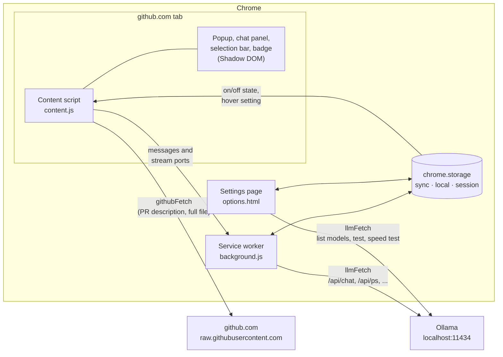
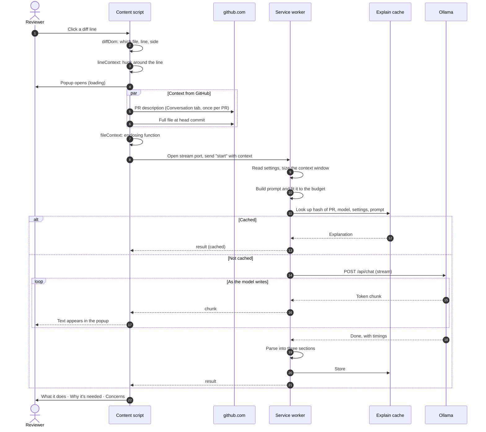
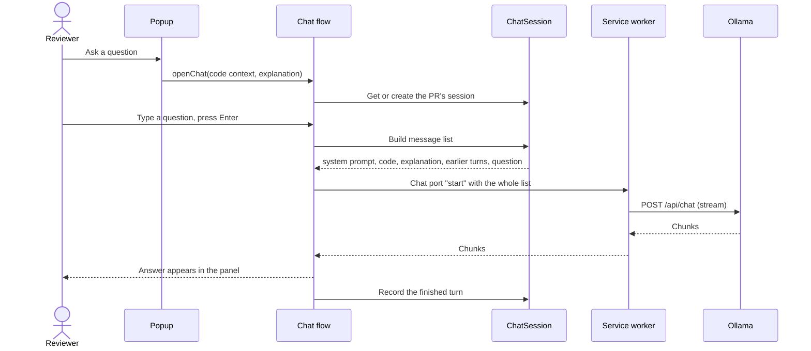

# Design and data flow

This page explains how PR Explainer is put together: the parts of the extension, what each one is allowed to do, and how a click on a diff line turns into a streamed explanation. For the modules and classes inside each part, see [Object design](object-design.md).

[← Back to the README](../README.md)

## Design goals

| Goal | What it means for the design |
|---|---|
| **Code stays on the laptop** | The only places the extension talks to are github.com and an LLM on `localhost`. Every request goes through one of two guarded fetch functions, and a test fails if any other code reaches the network. |
| **Never break GitHub** | All UI lives in Shadow DOM roots, so GitHub's CSS and ours never mix. Clicks on GitHub's own controls (links, the comment "+" button, menus, form fields) and modified clicks are ignored, and a toolbar button turns the feature off. |
| **Survive GitHub's markup** | Every GitHub-specific CSS selector lives in one file (`src/diffDom.ts`), tested against saved copies of GitHub's classic and new React diff pages in unified and split view. |
| **Feel fast on slow hardware** | Answers stream token by token, can be stopped, are cached, and can be prefetched on hover. The model is loaded before the first click. |
| **Small, reviewable changes** | The project was built in 37 roadmap PRs, each reviewable in under 20 minutes. See [Features and roadmap](planning.md). |

## The parts of the extension

A Chrome Manifest V3 extension is split into separate programs that cannot share memory. PR Explainer has three, plus the local LLM server.

| Part | Runs in | Responsible for | Can reach |
|---|---|---|---|
| **Content script** (`src/content.ts`) | Every github.com tab | Detecting PR pages, handling clicks, selections and Alt+E, reading the diff and the PR from the page, drawing the popup and chat, keeping chat history | github.com and raw.githubusercontent.com only (`src/net/githubFetch.ts`) |
| **Service worker** (`src/background.ts`) | The extension's background | Building prompts, fitting them to the context window, calling the LLM, streaming replies, caching explanations, warming up the model, the toolbar toggle | The configured LLM URL on this computer only (`src/net/llmFetch.ts`) |
| **Settings page** (`src/options/`) | Its own tab | Editing settings, listing models, testing the connection, GPU check, speed test | The configured LLM URL only |
| **Ollama** | A local process | Running the model | Nothing; it only answers |

### Why the LLM is called from the service worker

The content script runs inside the GitHub page. Calling Ollama from there would put the LLM address in the page and run into CORS rules. The service worker has `localhost` in the manifest's `host_permissions`, so it can call Ollama directly, and the content script only ever sends it plain text.

### Why the content script and service worker share no code

Chrome runs content scripts as classic scripts, not ES modules. If the two entries imported the same module, Vite would move it into a shared chunk loaded with `import`, which fails in a content script. So they share only TypeScript types (erased at build time). Where both need the same constant, such as a storage key or a prompt heading, each keeps its own copy and a unit test checks that the copies match. `npm run package` also compiles `content.js` as a classic script to catch a stray import before it ships.

## How a click becomes an explanation

Step by step:

1. **Locate.** `src/diffDom.ts` turns the clicked element into a `DiffLine`: file path, line number, and whether it is added, removed or unchanged. It handles GitHub's classic table layout and its new React layout, each in unified and split view.
2. **Collect the hunk.** `src/lineContext.ts` takes six lines before and after the clicked one from the same hunk, plus the hunk header and the file's language, and formats them as text with the clicked line marked `>`. A drag or Shift-click selection (`src/selection.ts`) does the same for a block of up to 100 lines.
3. **Collect PR context.** `src/prMetadata.ts` reads the PR title from the page and the description from the Conversation tab (fetched once per PR). `src/fileContext.ts` fetches the full file at the PR's head commit and finds the function or block the line sits in, by braces for C-like languages and by indentation for Python, Ruby and YAML. Both are best-effort: a failure or a slow fetch just leaves that part out.
4. **Stream to the service worker.** The content script opens a long-lived port (`chrome.runtime.connect`) and sends one `start` message. Closing the popup or pressing **Stop** disconnects the port, which aborts the request all the way to Ollama.
5. **Size the window.** `src/llm/contextSize.ts` decides the context window: the user's setting, or (when automatic) what the model's own settings ask for, capped at 4,096 tokens. `src/llm/numCtx.ts` rounds it to a power of two and reuses the window the model is already loaded with, because changing it makes Ollama reload the model.
6. **Build and fit the prompt.** `src/explain/explainPrompt.ts` puts everything that stays the same within a PR first, so Ollama can reuse its work from the previous click, and the clicked code last. `src/explain/fitPrompt.ts` estimates tokens and, if the prompt is too long, cuts in order: the file context, then the PR description, then the diff lines farthest from the clicked code. The instructions and the clicked code are never cut.
7. **Check the cache.** `src/explain/explainCache.ts` keys each explanation by a SHA-256 hash of the PR, model, temperature, response limit and the full prompt, so a new commit or a changed setting never shows a stale answer. It lives in `chrome.storage.session` (cleared when Chrome closes) and keeps the 100 most recently used entries.
8. **Call Ollama.** `src/llm/ollamaClient.ts` sends `POST /api/chat` with `stream: true`, the context window, the answer limit (120 tokens by default) and `keep_alive` (30 minutes by default), and yields each piece of the newline-delimited JSON reply.
9. **Parse.** `src/explain/parseExplanation.ts` splits the reply into the three sections. It copes with the ways local models drift from the format: different heading styles, text before the first heading, `<think>` blocks from reasoning models, missing sections, and answers cut off at the limit.
10. **Show.** `src/popup/popup.ts` renders the sections with a small Markdown renderer that never parses HTML (model output is untrusted), shows "Answered in …", and offers **Details** (a bar for each task of the click, from the trace in `src/trace/`), **Regenerate** and **Ask a question**.

Errors follow the same path back. The LLM client classifies a failure (`connection`, `model-not-found`, `origin-blocked`, `blocked`, and so on), and `src/llm/describeLlmError.ts` turns it into a message and a fix, such as the exact `OLLAMA_ORIGINS` command for Windows or macOS.

## Chat

The conversation lives in the content script, in memory only: one `ChatSession` per PR while the tab is open, never written to storage. The service worker is stateless for chat. It checks the shape of the message list, adds the user's settings, and streams the answer. While the chat is open, clicking another line adds that code to the session with a "Now looking at …" note instead of opening a popup, and the next question is sent with it.

## Other flows

| Flow | How it works |
|---|---|
| **Warm-up** | When a PR's Files changed tab opens, the content script sends a `warmup` request. The service worker checks `GET /api/ps` and, if the model is not loaded, sends an empty request that loads it with the window the first click will use. It runs once per tab and PR and never shows an error. |
| **Explain on hover** | `src/prefetch.ts` starts an explanation after the pointer rests on a line for 800 ms, through the same path as a click, so a finished prefetch is in the cache. A click on a line still being prefetched joins that request instead of starting another. Only one prefetch runs at a time. |
| **On/off toggle** | The toolbar button (service worker) writes the state to `chrome.storage.local`. Every tab's content script listens for the change and stops or starts handling clicks. The icon shows ON or OFF. |
| **In-page navigation** | GitHub moves between pages without a reload, and Chrome injects content scripts only on a full load. So the script runs on every github.com page and `src/navigation.ts` watches Turbo events, `history.pushState` and the address. Click-to-explain attaches on diff pages and detaches elsewhere. |
| **Theme** | `src/theme.ts` reads GitHub's `data-color-mode`, `data-light-theme` and `data-dark-theme` attributes (and the system setting for "auto") and sets `data-theme` on each panel's host. Every color is a CSS variable with light and dark values, and an open panel switches live. |
| **Settings** | `src/settings.ts` stores one key per field in `chrome.storage.sync`, so two pages saving different fields at the same time never overwrite each other. Only values the user changed are stored, so new defaults reach everyone else. |

## Storage

| Store | What | Lifetime |
|---|---|---|
| `chrome.storage.sync` | Settings (LLM URL, model, temperature, response length, context size, keep-loaded minutes, hover, show prompt) | Synced with the Chrome profile |
| `chrome.storage.local` | Whether click-to-explain is on | This computer only |
| `chrome.storage.session` | Explanation cache | Until Chrome closes |
| Content script memory | Chat sessions | Until the tab closes or reloads |

## Security boundaries

- **Two network guards.** The GitHub fetch (`createGithubFetch`) allows only `https://github.com` and `https://raw.githubusercontent.com`. The LLM fetch (`createLlmFetch`) allows only the configured LLM URL, and only when it is `localhost`, `127.0.0.1` or `[::1]`. Both refuse redirects instead of following them, so a server cannot bounce a prompt to another address.
- **A test that scans the source.** `tests/networkGuard.test.ts` fails if any code outside `src/net/` calls `fetch`, or anything uses `XMLHttpRequest`, `WebSocket`, `EventSource`, `sendBeacon`, or loads a script, image or stylesheet from the web. It also checks the content script bundles only the GitHub guard and the service worker only the LLM guard.
- **Narrow permissions.** The manifest asks for `storage`, github.com and this computer only, and `tests/manifest.test.ts` fails if a broader permission is added.
- **Untrusted model output.** Answers are rendered by a Markdown renderer that builds DOM nodes directly and never parses HTML.

[PRIVACY.md](../PRIVACY.md) covers the same ground for users, with steps to check it yourself in DevTools.
