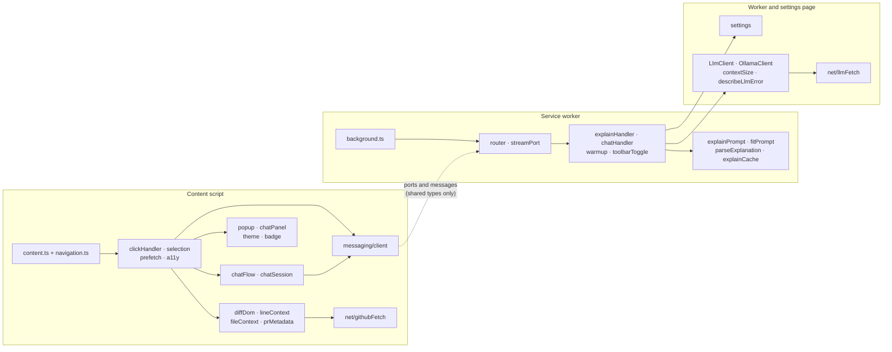
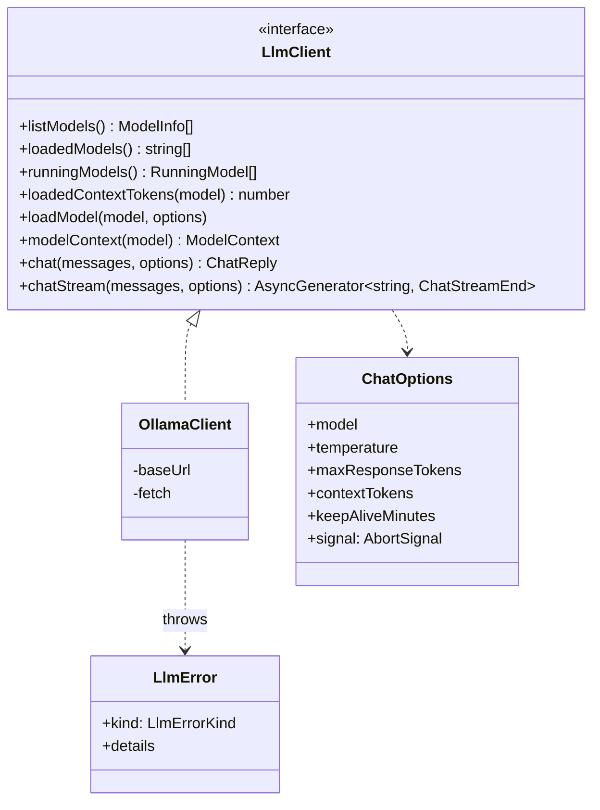

# Object design

This page describes the main modules, classes and interfaces in `src/`, grouped by the part of the extension they run in, and the patterns that hold them together. For how data moves between the parts at runtime, see [Design and data flow](design-and-data-flow.md).

[← Back to the README](../README.md)

## Patterns used throughout

- **Factories with injected dependencies.** Most logic is a `createX(deps)` function (`createExplainHandler`, `createClickHandler`, `createWarmup`, `createPrefetcher`, `createExplainCache`) that takes Chrome APIs, storage, the LLM client and timers as parameters. Production code wires in the real ones in the entry files (`content.ts`, `background.ts`, `options/main.ts`); tests pass fakes. This is why almost everything can be unit tested in jsdom without a browser.
- **Narrow "-Like" interfaces for Chrome.** Instead of depending on the whole `chrome` global, modules declare just the slice they use: `LocalStorageLike`, `SessionStorageLike`, `SyncStorageLike`, `ActionLike`, `PortLike`, `ExtensionRuntime`. A fake only has to implement those few methods.
- **Typed messaging.** One `RequestMap` type lists every request with its payload and result types, so the sender and the handler cannot drift apart.
- **Errors as data where the UI needs them.** The LLM client throws an `LlmError` with a `kind`. Handlers in the service worker catch it and return `{ message, fix }` as part of the result, because Chrome messaging only carries an error's name and message, and the popup needs the fix too.
- **Shadow DOM components.** The popup, chat panel, selection bar and badge each build their own shadow root and expose a small imperative interface (`Popup`, `ChatPanel`) rather than leaking DOM.
- **One file per GitHub dependency.** All GitHub CSS selectors are in `diffDom.ts`; all reading of PR metadata is in `prMetadata.ts`; all file fetching is in `fileContext.ts`.

## Module map

The dotted line is the only connection between the two halves: the content script and the service worker share TypeScript types from `messaging/protocol.ts` and nothing else at runtime (see [why](design-and-data-flow.md#why-the-content-script-and-service-worker-share-no-code)).

## Content script

| Module | Key exports | Role |
|---|---|---|
| `content.ts` | (entry) | Wires everything together on github.com pages: the badge, the ping, the enabled state, and a `DiffPageFeatures` that attaches click, selection and hover handling on diff pages. |
| `navigation.ts` | `watchNavigation`, `DiffPageFeatures`, `showsDiffs` | Notices GitHub's in-page navigation. `DiffPageFeatures.sync(url)` attaches features when a page shows diffs and calls the detach function when it stops. |
| `prUrl.ts` | `parsePrUrl`, `PrRef` | Turns a URL into `{ owner, repo, number, tab }`, or null. |
| `diffDom.ts` | `locateLine`, `locateRow`, `locateHunk`, `locateRange`, `DiffLine`, `DiffHunk`, `DiffRange` | The only file that knows GitHub's diff markup. Maps an event target to a line, side and file in classic or React layouts, unified or split. |
| `lineContext.ts` | `extractContext`, `formatContext`, `selectionContext`, `LineContext`, `SelectionContext` | Builds the text block the model sees: the hunk header, the language, and lines around the clicked one with `>` marking it. |
| `codeFacts.ts` | `lineFacts`, `factsFromHunk`, `selectionFacts`, `scopeFromHeader`, `CodeFacts` | What is known about clicked code without the model (PR 9.12): file and line, the function from the hunk header, and the kind of change, for the popup's facts line. |
| `fileContext.ts` | `findEnclosingBlock`, `buildFileContext`, `FileContextLoader` | Fetches the file at the head commit (public raw URL, then the signed-in blob page for private repos) and finds the enclosing block. |
| `prMetadata.ts` | `readPrMetadata`, `PrMetadataLoader`, `PrMetadata` | Reads the PR title and description, fetching the Conversation tab once per PR when needed. |
| `clickHandler.ts` | `createClickHandler`, `explainCode`, `explainInPopup`, `lineRequest` | Turns a click into an explanation: opens the popup, streams into it, wires Stop, Regenerate and Ask a question, and routes clicks to the chat while it is open. |
| `selection.ts` | `installSelection`, `selectionCode` | Drag or Shift-click selection of a block, the "Explain selection" bar, and the Alt+E shortcut. |
| `a11y.ts` | `isExplainShortcut`, `shortcutTarget`, `restoreFocus` | Keyboard helpers: matching Alt+E by key position, finding the focused line, returning focus. |
| `prefetch.ts` | `createPrefetcher`, `Prefetcher` | Explain on hover: one prefetch at a time, cancelled on move, joined by a click. |
| `popup/popup.ts` | `Popup`, `PopupState` | The explanation popup. States: `loading`, `streaming`, `done`, `failed`, `stopped`, `closed`. Shows timings and the optional prompt. |
| `popup/renderMarkdown.ts` | `renderMarkdown` | Safe Markdown to DOM for untrusted model output. |
| `popup/latencyBreakdown.ts` | `latencyBreakdown`, `latencyRows` | Splits "Answered in …" into load, prompt, answer and time outside Ollama. |
| `chat/chatSession.ts` | `ChatSession`, `ChatSessions`, `CHAT_SYSTEM_PROMPT` | The record of one conversation and the message list for the next question. `ChatSessions` keeps one per PR. No UI, no network. |
| `chat/chatPanel.ts` | `ChatPanel`, `ChatSubject` | The docked chat UI: message list, text box, Send/Stop, New chat. |
| `chat/chatFlow.ts` | `startChat`, `CurrentChat`, `ActiveChat` | Connects a `ChatSession` to a `ChatPanel` and the service worker. `CurrentChat` remembers which chat clicked code should go to. |
| `messaging/client.ts` | `sendRequest`, `openExplainStream`, `openChatStream`, `RequestError` | The content script's side of messaging: typed one-shot requests with a timeout, and stream ports. |
| `enabledState.ts`, `badge.ts`, `theme.ts` | `trackEnabled`, `showBadge`, `followTheme` | The on/off state, the "PR Explainer active" badge, and light/dark theming. |
| `net/githubFetch.ts` | `createGithubFetch`, `allowedGithubUrl`, `BlockedRequestError` | The only way the content script reaches the network. |

## Service worker

| Module | Key exports | Role |
|---|---|---|
| `background.ts` | (entry) | Creates the handlers with real dependencies and registers them on the router and stream ports. In development builds it exposes `debugLlm` and `debugSettings` in the worker console. |
| `messaging/router.ts` | `MessageRouter` | A registry of one-shot request handlers (`ping`, `warmup`) behind `chrome.runtime.onMessage`. `.on(type, handler)` is typed by `RequestMap`. |
| `messaging/streamPort.ts` | `listenForExplainPorts`, `listenForChatPorts` | Runs one streaming request per port, forwards chunks, and aborts when the port disconnects. |
| `explain/explainHandler.ts` | `createExplainHandler`, `ExplainPayload`, `ExplainResult` | Settings → context size → fitted prompt → cache lookup → stream from the LLM → parse → cache store. Returns either an explanation or `{ message, fix }`. |
| `explain/explainPrompt.ts` | `assembleExplainPrompt`, `EXPLAIN_SYSTEM_PROMPT`, `SECTION_HEADINGS` | The prompt text, ordered so the stable part comes first for Ollama's prompt cache. |
| `explain/fitPrompt.ts` | `buildFittedExplainPrompt`, `PromptReport` | Fits the prompt to the context window and reports what was trimmed. |
| `explain/tokenBudget.ts` | `estimateTokens`, `fitToBudget`, `PromptTooLargeError` | A tokenizer-free token estimate (deliberately a little high) and a generic "cut the least important part first" algorithm. |
| `explain/parseExplanation.ts` | `parseExplanation`, `Explanation` | Turns a free-form reply into `{ what, why, concerns }`. |
| `explain/explainCache.ts` | `createExplainCache`, `explainCacheKey` | LRU cache in `chrome.storage.session`, keyed by a SHA-256 hash. A failing read is a miss and a failing write is ignored. |
| `chat/chatHandler.ts` | `createChatHandler` | Validates the message list from the content script and streams the answer. |
| `llm/warmup.ts` | `createWarmup` | Loads the model when a Files changed tab opens, once per tab and PR. |
| `llm/contextSize.ts`, `llm/numCtx.ts` | `createContextSizer`, `promptBudget`, `chooseNumCtx` | Decide the context window and keep it stable so Ollama does not reload the model. |
| `toolbarToggle.ts` | `setupToolbarToggle` | The toolbar button and its ON/OFF badge. |

## Shared by the service worker and the settings page

### `LlmClient` and `OllamaClient`

Every caller depends on the `LlmClient` interface and gets an instance from `createLlmClient(settings)`. Ollama is the only implementation today; adding LM Studio or a llama.cpp server means a new class and a change to `createClient.ts`, nothing else. `chatStream` is an async generator, so callers use `for await` and leaving the loop early (or aborting the signal) cancels the HTTP request.

`LlmErrorKind` is one of `connection`, `model-not-found`, `origin-blocked`, `no-model`, `bad-response`, `http`, `aborted` or `blocked`. `describeLlmError` maps each to a user-facing `{ message, fix }`.

### Settings

`settings.ts` defines the `Settings` interface and `DEFAULT_SETTINGS`:

| Field | Default | Meaning |
|---|---|---|
| `llmUrl` | `http://localhost:11434` | Must be on this computer |
| `model` | (empty) | Picked from the installed models |
| `temperature` | `0.2` | Sampling temperature |
| `maxResponseTokens` | `120` | Answer limit for explanations (chat gets at least 1,024) |
| `contextTokens` | `0` | `0` means automatic |
| `keepAliveMinutes` | `30` | How long Ollama keeps the model loaded |
| `explainOnHover` | `false` | Prefetch on hover |
| `showPrompt` | `false` | Show the prompt under each explanation |
| `debugWindow` | `false` | Keep every round trip in the debug log (PR 9.3) |

Each field is stored under its own key (`settings.<field>`) and validated on its own, so concurrent saves of different fields are safe.

## Messaging protocol

Defined in `src/messaging/protocol.ts`, as types only.

| Channel | Direction | Shape |
|---|---|---|
| `ping` request | content → worker | `{ receivedAt }` back |
| `warmup` request | content → worker | `WarmupPayload` → `WarmupResult` (`repeat`, `off`, `no-model`, `already-loaded`, `loaded`, `failed`) |
| `pr-explainer:explain` port | content ↔ worker | `start` + `ExplainPayload` → any number of `chunk`, then one `result` or `error` |
| `pr-explainer:chat` port | content ↔ worker | `start` + `ChatPayload` (the full message list) → `chunk`s, then `result` or `error` |
| `debugLogAdd` request | content → worker | `DebugLogPayload` (a click's GitHub round trips and trace) → `{ added }`; kept only with **Debug window** on |
| `debugLogClear` request | extension page → worker | empties the debug log → `{ cleared: true }` |
| `pr-explainer:debugLog` port | worker → extension page | each new `DebugEntry` as `{ type: 'entry' }`, and `{ type: 'cleared' }`; GitHub pages cannot connect |

Every one-shot message carries `source: 'pr-explainer'` so the worker ignores anything else. Disconnecting a port aborts its request.

## Tests

Each module above has a matching file in `tests/` (for example `diffDom.test.ts`, `fitPrompt.test.ts`, `ollamaClient.test.ts`). DOM code is tested in jsdom against saved GitHub pages in `tests/fixtures/` (classic and new layouts, unified and split, a PR conversation page and a file page). Cross-cutting tests check the boundaries the design relies on: `networkGuard.test.ts`, `manifest.test.ts`, the copies of shared constants, and `package.test.ts` for the release zip. See the [Developer guide](developer.md#tests) for how to run them.
